<picture><source media="(max-width: 600px) and (prefers-color-scheme: dark)" srcset="./assets/c-hero-dark-m.svg"><source media="(max-width: 600px)" srcset="./assets/c-hero-light-m.svg"><source media="(prefers-color-scheme: dark)" srcset="./assets/c-hero-dark.svg"></picture>

<picture><source media="(max-width: 600px) and (prefers-color-scheme: dark)" srcset="./assets/c-stack-dark-m.svg"><source media="(max-width: 600px)" srcset="./assets/c-stack-light-m.svg"><source media="(prefers-color-scheme: dark)" srcset="./assets/c-stack-dark.svg"></picture>

<a href="https://github.com/HiamRyuthere/Quine_Institute_Backend"><picture><source media="(max-width: 600px) and (prefers-color-scheme: dark)" srcset="./assets/card1-dark-m.svg"><source media="(max-width: 600px)" srcset="./assets/card1-light-m.svg"><source media="(prefers-color-scheme: dark)" srcset="./assets/card1-dark.svg"></picture></a>

<a href="https://github.com/HiamRyuthere/Ephernal-Chat-Backend"><picture><source media="(max-width: 600px) and (prefers-color-scheme: dark)" srcset="./assets/card2-dark-m.svg"><source media="(max-width: 600px)" srcset="./assets/card2-light-m.svg"><source media="(prefers-color-scheme: dark)" srcset="./assets/card2-dark.svg"></picture></a>

<picture><source media="(max-width: 600px) and (prefers-color-scheme: dark)" srcset="./assets/card3-dark-m.svg"><source media="(max-width: 600px)" srcset="./assets/card3-light-m.svg"><source media="(prefers-color-scheme: dark)" srcset="./assets/card3-dark.svg"></picture>

<a href="https://github.com/HiamRyuthere/a-404-game"><picture><source media="(max-width: 600px) and (prefers-color-scheme: dark)" srcset="./assets/card4-dark-m.svg"><source media="(max-width: 600px)" srcset="./assets/card4-light-m.svg"><source media="(prefers-color-scheme: dark)" srcset="./assets/card4-dark.svg"></picture></a>

<picture><source media="(max-width: 600px) and (prefers-color-scheme: dark)" srcset="./assets/c-path-dark-m.svg"><source media="(max-width: 600px)" srcset="./assets/c-path-light-m.svg"><source media="(prefers-color-scheme: dark)" srcset="./assets/c-path-dark.svg"></picture>

<picture><source media="(max-width: 600px) and (prefers-color-scheme: dark)" srcset="./assets/c-contact-dark-m.svg"><source media="(max-width: 600px)" srcset="./assets/c-contact-light-m.svg"><source media="(prefers-color-scheme: dark)" srcset="./assets/c-contact-dark.svg"></picture>

[Signal](https://signal.me/#eu/gax2Kci9oweU9xxUyidB3Gt2Q2R8xppFHOq6Oekjx5MOLCxV4SxMb5hVmCLJOegr) · [Mastodon](https://mastodon.social/@hiamryu) · [LinkedIn](https://linkedin.com/in/hiamharsh) · [Email](mailto:public_email.nursing034@aleeas.com)
